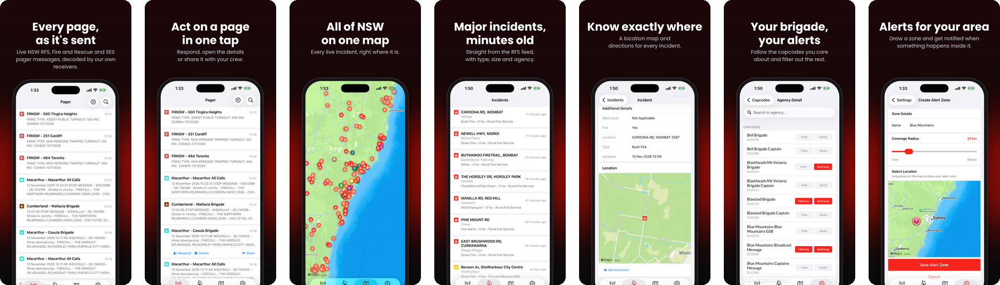

<p align="center">
  <a href="https://rfspager.app"></a>
</p>

<h1 align="center">RFSPager</h1>

<p align="center">
  <strong>Live NSW emergency pager messages, incidents and alerts, decoded from the airwaves by a community network of radio receivers.</strong>
</p>

<p align="center">
  <a href="https://rfspager.app"><b>rfspager.app</b></a> ·
  <a href="https://rfspager.app/pager">Live feed</a> ·
  <a href="https://rfspager.app/map">Map</a> ·
  <a href="https://rfspager.app/coverage">Coverage</a> ·
  <a href="https://rfspager.app/host">Host a receiver</a> ·
  <a href="https://rfspager.app/docs">Public API</a>
</p>

<p align="center">
  <a href="https://apps.apple.com/au/app/rfspager/id1568913265"></a>
  &nbsp;
  <a href="https://play.google.com/store/apps/details?id=io.devlan.rfspager"></a>
</p>

<p align="center">
  
</p>

## What it does

- **Every page, as it's sent.** RFS, Fire and Rescue NSW and SES pager traffic appears in the app and on [the website](https://rfspager.app/pager) seconds after it goes out, with the brigade or station it was sent to.
- **All of NSW on one map.** Live pages with locations, major incidents from the RFS feed, and hazard reduction burns.
- **Alerts for what matters to you.** Follow your brigade's capcodes, filter out the rest, and draw alert zones to get a push notification when something happens in your area.
- **We listen to the radio, we don't scrape websites.** Messages come from RTL-SDR receivers run by volunteers across NSW. See [where we have coverage](https://rfspager.app/coverage), and if your area is quiet, [host a receiver](https://rfspager.app/host): hosts get Pro free while their receiver runs.
- **Free to use.** The feed, map and incidents are free. Pro adds push notifications, alert zones, capcode filtering and no ads.

RFSPager is an independent community project. It is not affiliated with, endorsed by, or operated by NSW Rural Fire Service, Fire and Rescue NSW, NSW State Emergency Service, or any other agency; their names are used only to describe the traffic the receivers hear. It is an information tool, not an official dispatch or life-safety system: never rely on it to respond to an emergency. In an emergency, call **000**.

---

## For developers

This repository contains everything that runs [rfspager.app](https://rfspager.app): the Go API and receiver, the React web application, and the Expo mobile application.

Licensed under **[GNU AGPLv3](LICENSE.md)** (`AGPL-3.0-only`). Preserve copyright and license notices. Covered derivatives distributed to others remain under AGPLv3; modified versions served over a network must offer their corresponding source to remote users. Commercial use is permitted subject to the license. Third-party components retain their own licenses; see [NOTICE](NOTICE) and [third-party notices](THIRD_PARTY_NOTICES.md).

## Status

The Go server has run production since October 2026 and replaced the earlier Laravel backend, which is retired. The repository contains no operational data or credentials. Running the Go server starts importers and notification workers; use `cmd/migrate` when you intend only to change schema (see the [database migration procedure](docs/database-migration.md)).

## Layout

- `cmd/server`: API, ingestion, importers, notification workers.
- `cmd/receiver`: RTL-SDR POCSAG receiver using authenticated WebSocket transport, with a local dashboard (`apps/receiver-ui`, embedded at build time).
- `cmd/migrate`: schema-only migration command.
- `cmd/replay`, `cmd/send-test`, `cmd/rxui-demo`: development tools (replay captured audio, send a test page, run the receiver dashboard on fake data).
- `cmd/apple-notify-test`, `cmd/google-sub-check`: read-only operator checks for App Store notifications and Play subscriptions.
- `internal`: Go services, embedded schema migrations, and tests.
- `apps/web`: React Router/Vite public site, API docs (`/docs`), and administration console.
- `apps/mobile`: Expo/React Native iOS and Android application.
- `apps/receiver-ui`: the receiver's local dashboard.
- `docs`: development, integration, and operating procedures.

## Local development

Use Go **1.27.4**, Node **22**, pnpm **10** for mobile, and npm for web. PostgreSQL **16** with PostGIS is required. Docker Compose provides a disposable loopback-only development database with no persistent volume:

```sh
docker compose up -d postgres
cp .env.example .env
# Set JWT_SECRET to the output of: openssl rand -hex 32
# Set DATABASE_URL to the local connection below.
# To create an administrator, explicitly set ADMIN_EMAIL and a strong ADMIN_PASSWORD.
export DATABASE_URL='postgres://postgres@127.0.0.1:55432/rfspager_test?sslmode=disable'
go run ./cmd/migrate
go run ./cmd/server
```

`cmd/server` reads `.env`; the schema-only migration command deliberately uses its explicit `DATABASE_URL` environment variable. No administrator is created unless bootstrap credentials are supplied. Bootstrap passwords must be 12–72 bytes. JWT secrets are required, must be independently generated, and must not be shared between installations.

In separate terminals:

```sh
cd apps/web
npm ci
npm run dev
```

```sh
cd apps/mobile
pnpm install --frozen-lockfile
# Configure your own Firebase/provider files and native development build first.
EXPO_PUBLIC_API_URL=http://localhost:8080 pnpm dev
```

The web development proxy forwards `/api` to `localhost:8080`. For a physical mobile device, set `EXPO_PUBLIC_API_URL` to a development server reachable from that device. Mobile defaults to loopback; forks never silently connect to production. See [mobile configuration](apps/mobile/README.md) and [environment reference](.env.example).

For mobile builds, supply your own Firebase config through `GOOGLE_SERVICE_INFO_PLIST` and `GOOGLE_SERVICES_JSON`, or their documented local files. Set `EXPO_PUBLIC_GOOGLE_MAPS_API_KEY`, `EXPO_PUBLIC_FACEBOOK_APP_ID`, `EXPO_PUBLIC_FACEBOOK_CLIENT_TOKEN`, `EXPO_PUBLIC_EAS_PROJECT_ID`, and `APPLE_TEAM_ID` as needed. Google Maps keys must be restricted to your application and APIs. Configure `EXPO_PUBLIC_API_URL` separately in each EAS build environment. App-store submission IDs, signing credentials, and provider accounts belong to the deployment, not this repository.

## Receivers

Provision an owner and approve a receiver in the administration UI. Each receiver gets its own generated key. Supply it through a protected environment file; don't put credentials in source, URLs, shared screenshots, or issue reports.

```sh
brew install librtlsdr    # macOS local builds
make receiver
RECEIVER_SERVER_URL=https://pager.example.org RECEIVER_API_KEY="$MY_RECEIVER_KEY" ./bin/receiver
```

Docker builds are available with `Dockerfile.receiver`; USB device access is needed when running the image. Receiver settings include `RECEIVER_SAMPLE_RATE`, `RECEIVER_TUNER_GAIN`, `RECEIVER_PPM`, `RECEIVER_DONGLE_INDEX`, `RECEIVER_DONGLE_SERIAL`, `RECEIVER_STATE_DIR`, and `RECEIVER_UI_ADDR` (local dashboard, default `:8148`; see [receiver local UI](docs/receiver-local-ui.md)).

The server accepts authenticated `POST /api/messages`, `GET /api/receiver/me`, and `GET /api/receiver/ws`. Only approved receivers with an active owner and key can authenticate. HTTPS is required except on loopback for local development. Legacy UUID-only ingress, Laravel Sanctum ingress, and receiver legacy backfeed have been removed. Old legacy environment variables fail startup explicitly.

## Authentication and billing

Admin and mobile JWTs have distinct audiences and token types. Credential changes and logout revoke sessions. The same admin checks protect streaming endpoints. Changing the JWT secret also invalidates issued sessions.

Password recovery is available after configuring either a [Libredesk](https://libredesk.io) help desk (`LIBREDESK_*`, which takes precedence) or SMTP; without either, the endpoint explicitly reports unavailability. SMTP requires verified TLS, except for an explicit loopback development mode. The web application includes `/forgot-password` and `/reset-password`.

Stripe requires a webhook signing secret and configured price IDs. Apple and Google purchases are validated against deployment-specific product and environment allowlists. Apple signed transactions and notifications must carry Apple's App Store signing chain; with App Store Server API credentials configured, a transaction Apple has no record of is rejected. Google notifications are OIDC-verified and re-read from the Play API. See [IAP webhook setup](docs/iap-webhooks.md).

Only explicitly trusted proxy CIDRs may supply forwarded client addresses to the authentication limiter. Configure `TRUSTED_PROXY_CIDRS` when using a reverse proxy, and use an additional shared edge limit for multiple API replicas. Application request logs omit query strings; configure your proxy/access-log sink to omit or redact credential-bearing query parameters too.

## Verification

```sh
go test ./... -count=1
go vet ./...
go build ./...
(cd apps/web && npm run typecheck && npm run build)
(cd apps/mobile && pnpm exec tsc --noEmit)
```

Database tests are opt-in because they reset a disposable schema:

```sh
export RFSPAGER_TEST_DATABASE_URL='postgres://postgres@127.0.0.1:55432/rfspager_test?sslmode=disable'
RFSPAGER_TEST_INSTALLATION_DATABASE_URL="$RFSPAGER_TEST_DATABASE_URL" \
  go test -p 1 ./internal/db ./internal/iap ./internal/mobile -count=1
docker compose down
```

Never supply a production connection to tests. CI runs code checks, dependency audits, and a redacted secret scan.

## Contributing and security

Community contributions are welcome. Start with [CONTRIBUTING.md](CONTRIBUTING.md); report vulnerabilities privately using [SECURITY.md](SECURITY.md). Use synthetic data in tests and issue reports.
